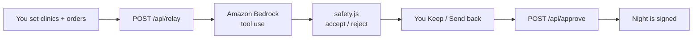

# Relay

### Harborlight Continuity Desk · SpartHill Hacks 2026 · AWS Track

[](https://nodejs.org)
[](https://aws.amazon.com/bedrock/)
[](https://aws.amazon.com/polly/)
[](https://react.dev)
[](#team)

> When clinics go dark at 2:14 a.m., someone still needs a chair, a van, and a decision.

**Relay** is the continuity desk for **Naomi Brooks** at Harborlight Dialysis — six clinics, ~420 patients, one flood night.

| Who | Role |
|-----|------|
| **You (Naomi)** | Set the night. Keep or send back every move. Approve. |
| **Amazon Bedrock** | Drafts who finishes on the machine and who transfers. |
| **Safety code** | Rejects dark clinics, overfilled vans, impossible fuel. |
| **Kiro** | Helped build and document the project (not in the runtime path). |

Fictional adult patients · aggregate ops data · **not a medical device**.

---

## Why this exists

Coastal flood. Pier and South Wharf fail. Eastbank runs on ~40 minutes of generator fuel. Thirteen adults need a place before morning. Two wheelchair vans. Five seats. No stretcher.

Relay turns that chaos into one draft — then forces a **human gate** before anything is final.



---

## Try it

```bash
git clone https://github.com/Charannagadeep/harborlight-relay.git
cd harborlight-relay
npm install
cp .env.example .env   # workshop AWS keys — never commit .env
npm run dev
```

| | URL |
|---|-----|
| Desk | http://127.0.0.1:5173 |
| API health | http://127.0.0.1:8787/api/health |

### On the desk (silent · interactive)

1. **Work the night**
2. **Load the Tuesday flood**
3. Flip power / water / fuel / chairs / roads — write orders if you want
4. **Ask Bedrock for a draft**
5. **Keep** or **Send back** each person
6. **Approve kept moves** (or reject the whole draft and ask again)

If every clinic is dark, Relay refuses a fake plan. There is nowhere safe to send anyone.

### Modes

| Mode | Route | What it is |
|------|-------|------------|
| **Desk** | `#desk` | Main product — silent, you drive |
| **Architecture** | `#arch` | Bedrock · safety · human approve · Kiro |
| **Film** | `#film` | Cinema take for the live demo (Polly + natural SFX) |

---

## Amazon Bedrock (runtime AI)

Bedrock is the **planner inside the app**. It must call three read tools, then submit once:

| Tool | Returns |
|------|---------|
| `get_clinic_status` | Power, water, road, generator minutes, open chairs |
| `get_patients_requiring_placement` | Everyone who needs a decision (incl. mid-treatment) |
| `get_transport_and_roads` | Van seats, shuttle limits, closed / van-only roads |
| `submit_plan` | One night plan for Naomi to review |

Model id is resolved from Bedrock inference profiles in `us-east-1` (Claude Sonnet family).

### Safety gate (code, not the model)

`server/safety.js` rejects plans that:

- send someone to a clinic that cannot receive
- overfill chairs or wheelchair van seats
- waste a van seat on someone the shuttle could move
- leave someone on a machine the generator cannot cover

If the model cannot repair, a deterministic **rules** fallback places the night and the UI labels `source: "rules"`.

### Human approve

Nothing is final until `POST /api/approve`. Keep / send-back edits travel with the approval log.

### Patient notifications (Bedrock + SES + Polly)

After Naomi approves, the **Notify** tab turns each kept move into a message to the person who has to act on it:

1. **Bedrock drafts** one message per patient, in their language (English, Spanish, Korean), through a required `submit_messages` tool. People finishing on the machine get a message to their emergency contact instead.
2. **Code checks every message** (`server/notify.js`, `checkMessages`): right clinic, leave-by time, hotline number, "do not go to" the closed clinic, and no medical advice. Failures go back to Bedrock as tool errors for repair; if it still fails, a plain template is shown and labeled.
3. **Naomi reads, edits, and unticks** any message before it goes.
4. **Amazon SES** emails the approved messages and **Amazon Polly** renders each one as a voice call in the matching neural voice (Joanna, Lupe, Seoyeon).

Set `SES_FROM` and `NOTIFY_TO` (both verified in SES) to send for real. In SES sandbox every fictional patient is routed to `NOTIFY_TO` with a plus tag, for example `you+irene@gmail.com`. Leave `NOTIFY_TO` blank and sends are previewed only.

---

## The Tuesday flood

Default crisis in `shared/world.js` (editable on the desk):

| Clinic | State |
|--------|--------|
| Pier · South Wharf | Flooded / dark |
| Eastbank | Generator ~40 min · four people mid-treatment |
| Cedar Grove | High vans only |
| Main · North Ridge | Still receiving |

**13 adults** need finish-on-machine or transfer by van / shuttle.

---

## Stack

```
harborlight-relay/
├── client/          React 19 + Vite desk, architecture, film
├── server/          Express · Bedrock Converse · Polly · safety
├── shared/          World scenario + film script lines
├── scripts/         Optional local film recorder (outputs stay gitignored)
├── KIRO_TASK.md     Prompt used for the Kiro documentation pass
└── .env.example     Credential template — no secrets
```

| Piece | Tech |
|-------|------|
| UI | React, Vite |
| API | Express, SSE (`/api/relay`) |
| Planning | `@aws-sdk/client-bedrock-runtime` tool use |
| Notifications | Amazon SES email · Amazon Polly voice (`server/notify.js`) |
| Voice (film) | Amazon Polly neural |
| Builder | [Kiro](https://kiro.dev) CLI / IDE |

```bash
npm run check         # safety self-test on the Tuesday plan
npm run check:notify  # notification self-test (no AWS needed)
npm run build   # client → dist/
```

---

## Environment

Workshop credentials only. **Never commit `.env`.**

```bash
AWS_DEFAULT_REGION=us-east-1
AWS_ACCESS_KEY_ID=
AWS_SECRET_ACCESS_KEY=
AWS_SESSION_TOKEN=
# optional
BEDROCK_MODEL_ID=us.anthropic.claude-sonnet-4-5-20250929-v1:0
# patient notifications (blank NOTIFY_TO = preview only)
SES_FROM=
NOTIFY_TO=
NOTIFY_PLUS_TAGS=true
GUARDRAIL_ID=
GUARDRAIL_VERSION=
```

---

## Kiro vs Bedrock

| | **Kiro** | **Amazon Bedrock** |
|---|----------|---------------------|
| When | Build / docs time | Every live draft |
| Where | Outside the running site | `server/bedrock.js` |
| Proof | `KIRO_TASK.md` + architecture copy | Live tool traces on the desk |

**Persona.** Naomi Brooks owns six clinics and every signed plan. Relay never moves a patient alone.

---

## Team

Repo: [Charannagadeep/harborlight-relay](https://github.com/Charannagadeep/harborlight-relay)

| | |
|---|---|
| Owner | [Charannagadeep](https://github.com/Charannagadeep) |
| Collab | [Gundananda](https://github.com/Gundananda) · [juileegiramkar](https://github.com/juileegiramkar) · [SuprithaMallaradhya](https://github.com/SuprithaMallaradhya) |

Accept invites: https://github.com/Charannagadeep/harborlight-relay/invitations

---

<p align="center">
  <b>Relay</b> — Bedrock drafts the night. Code blocks the unsafe. A person signs.
</p>
